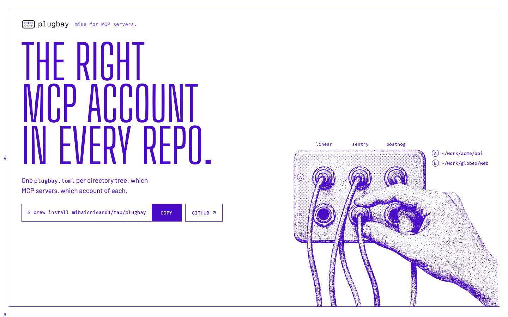

# plugbay-web

The landing page for [plugbay](https://github.com/mihaicrisan04/plugbay), mise for MCP servers. Live at [plugbay.mihaicrisan.com](https://plugbay.mihaicrisan.com).

<picture>
  <source media="(prefers-color-scheme: dark)" srcset="docs/screenshot-dark.png">
  
</picture>

One static page, drawn as an engineering sheet: one ink, 1px lines, and the real `plugbay.toml` files and commands set like a drawing.

## Stack

[Astro](https://astro.build) with static output and [Tailwind CSS](https://tailwindcss.com) v4. No client framework: the page is CSS and a few small inline scripts, and its one interaction works with JavaScript off.

## Develop

[mise](https://mise.jdx.dev) pins Node and Bun.

```sh
mise install
bun install
bun run dev      # http://localhost:4321
```

Before pushing:

```sh
bunx playwright install chromium   # once
bun run verify                     # lint, types, build, browser tests
```

## Where things live

| Path | What |
| --- | --- |
| `src/data/plugbay.ts` | Every command and config on the page. The build fails if a drawing and this file disagree. |
| `src/components/` | The zones of the sheet, A to D, and their figures. |
| `src/styles/global.css` | Colour and type tokens, and the parts every zone shares. |
| `DESIGN.md` | The design system, written from the shipped page. |
| `scripts/` | Screenshot tool and the dark-theme illustration build. |
| `archive/directions/` | The four prototypes the design was chosen from. |

## Deploy

A push to `main` deploys to production on Vercel. Other branches get a preview.

## License

[Apache-2.0](LICENSE). Big Shoulders is bundled under the [SIL Open Font License](public/fonts/sheet/BigShoulders-OFL.txt).
